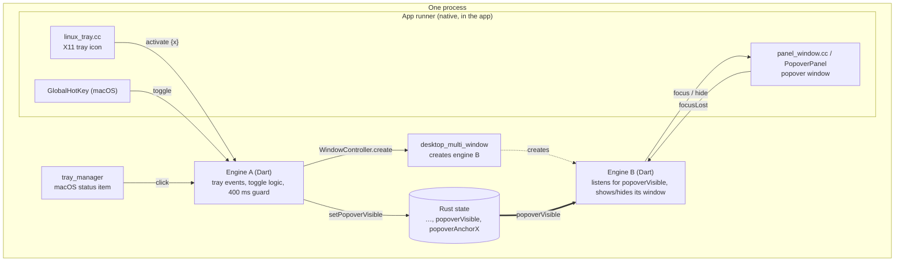
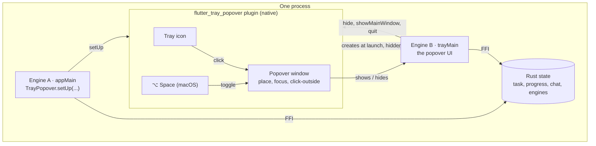
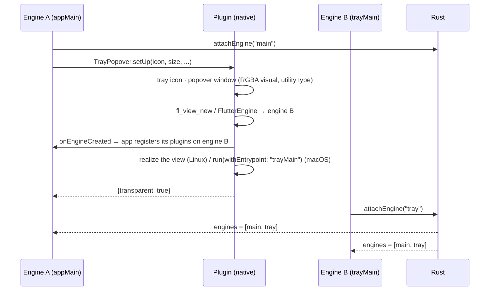
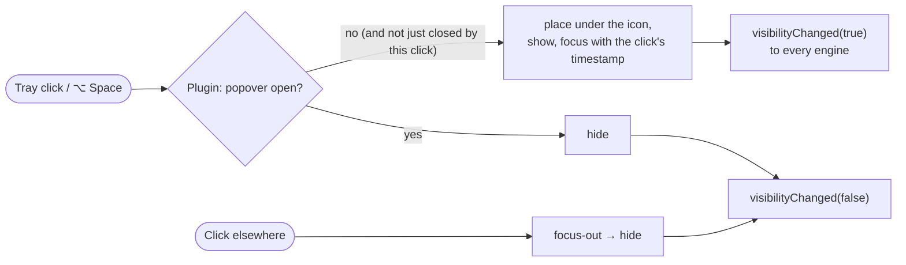

# Walkthrough: moving the tray and popover into a plugin

This describes the change that is **staged but not committed**: the tray icon,
the popover window and the second Flutter engine move out of the app into a
reusable plugin, [`packages/flutter_tray_popover`](packages/flutter_tray_popover).
The app keeps its UI, its Rust state and one line per runner.

To review the change itself:

```bash
git diff --cached --stat     # 46 files: 45 for the change, plus this walkthrough
git diff --cached            # the full change
```

- [0. How Flutter plugins work](#0-how-flutter-plugins-work)
- [1. In one paragraph](#1-in-one-paragraph)
- [2. Architecture before and after](#2-architecture-before-and-after)
- [3. What changes in the flows](#3-what-changes-in-the-flows)
- [4. The plugin](#4-the-plugin)
- [5. What changes in the app](#5-what-changes-in-the-app)
- [6. Files](#6-files)
- [7. Testing](#7-testing)
- [8. Open points](#8-open-points)

## 0. How Flutter plugins work

A Flutter app is Dart code running inside a native host app (the "runner").
Dart can't call GTK, AppKit or Win32 directly. A **plugin** is a package that
bridges that gap: **Dart code plus native code for each platform**, talking to
each other over named message channels.
([Developing packages & plugins](https://docs.flutter.dev/packages-and-plugins/developing-packages),
[Using packages](https://docs.flutter.dev/packages-and-plugins/using-packages))

### 0.1 What a plugin contains

```
flutter_tray_popover/
  pubspec.yaml          declares it's a plugin, and its native class per platform
  lib/                  the Dart API the app calls
  linux/                C/C++ (GTK), built with CMake
  macos/                Swift (AppKit), built with CocoaPods (the .podspec)
```

`pubspec.yaml` tells Flutter which native class to register on each platform:

```yaml
flutter:
  plugin:
    platforms:
      linux:
        pluginClass: FlutterTrayPopoverPlugin
      macos:
        pluginClass: FlutterTrayPopoverPlugin
```

An app uses it like any package, here by path:

```yaml
# the app's pubspec.yaml
dependencies:
  flutter_tray_popover:
    path: packages/flutter_tray_popover
```

### 0.2 How a plugin gets connected: the generated registrant

At build time, Flutter scans the app's plugin dependencies and **generates** a
registrant: one function that registers every plugin's native class with an
engine. The app never edits these files. For this app they contain:

```c
// linux/flutter/generated_plugin_registrant.cc (generated)
void fl_register_plugins(FlPluginRegistry* registry) {
  g_autoptr(FlPluginRegistrar) flutter_tray_popover_registrar =
      fl_plugin_registry_get_registrar_for_plugin(registry, "FlutterTrayPopoverPlugin");
  flutter_tray_popover_plugin_register_with_registrar(flutter_tray_popover_registrar);
}
```
```swift
// macos/Flutter/GeneratedPluginRegistrant.swift (generated)
func RegisterGeneratedPlugins(registry: FlutterPluginRegistry) {
  FlutterTrayPopoverPlugin.register(with: registry.registrar(forPlugin: "FlutterTrayPopoverPlugin"))
}
```

The runner calls this for its engine at startup (`fl_register_plugins(...)` in
`my_application.cc`, `RegisterGeneratedPlugins(...)` in
`MainFlutterWindow.swift`). The build also links each plugin's native code
into the app: `linux/flutter/generated_plugins.cmake` lists
`flutter_tray_popover`, and CocoaPods adds the pod on macOS.

### 0.3 How Dart and native code talk: method channels

When a plugin registers, its native code opens a **method channel**, a named
two-way pipe on that engine. Dart sends a method name and arguments, and the
native side answers asynchronously
([platform channels](https://docs.flutter.dev/platform-integration/platform-channels),
[`MethodChannel`](https://api.flutter.dev/flutter/services/MethodChannel-class.html)).
Values are encoded with the
[`StandardMethodCodec`](https://api.flutter.dev/flutter/services/StandardMethodCodec-class.html)
(numbers, strings, lists, maps).

**Dart side** (`lib/flutter_tray_popover.dart`):

```dart
static const _channel = MethodChannel('flutter_tray_popover');

static Future<void> show() => _channel.invokeMethod('show');
```

**Native side** (`linux/flutter_tray_popover_plugin.cc`), with the same channel
name:

```c
void flutter_tray_popover_plugin_register_with_registrar(FlPluginRegistrar* registrar) {
  ...
  FlMethodChannel* channel =
      fl_method_channel_new(fl_plugin_registrar_get_messenger(registrar),
                            kChannelName, FL_METHOD_CODEC(codec));   // "flutter_tray_popover"
  fl_method_channel_set_method_call_handler(channel, method_call_cb, view, nullptr);
  ...
}

void method_call_cb(FlMethodChannel*, FlMethodCall* method_call, gpointer user_data) {
  ...
  } else if (g_strcmp0(method, "show") == 0) {
    if (!popover_visible()) show_popover(-1);
  ...
}
```

Messages go the other way too. The native side calls Dart over the same
channel, which is how the plugin reports `visibilityChanged` to every engine:

```c
fl_method_channel_invoke_method(channel, "visibilityChanged", value, ...);
```
```dart
_channel.setMethodCallHandler((call) async {
  if (call.method == 'visibilityChanged') _visibility.add(call.arguments == true);
});
```

If Dart calls a channel nobody registered, it gets a
**`MissingPluginException`**.

### 0.4 Why plugins must be registered on every engine

Channels belong to an **engine** (its binary messenger). A plugin registered on
engine A has channels on engine A only. A second engine starts with **no
plugins at all**, so the same Dart call made from engine B fails with
`MissingPluginException`, unless the plugins are registered on engine B too.

Only the app can do that, because the generated registrant
(`fl_register_plugins` / `RegisterGeneratedPlugins`) is the app's own code.
That's why this plugin asks the runner for a callback, which it calls with
engine B (section 3.3).

The native **code** is still loaded once per process. Registering on two
engines gives two channels into the same native library, so both engines reach
the same tray icon and the same popover (section 4).

### 0.5 Other kinds of plugins, for context

- **FFI plugins** call native code directly through `dart:ffi`, without
  channels ([FFI plugins](https://docs.flutter.dev/packages-and-plugins/developing-packages#ffi)).
  The app's Rust library, through flutter_rust_bridge, works this way. That's
  why it needs **no** per-engine registration: each isolate just calls
  `RustLib.init()`.
- **Federated plugins** split one plugin into a Dart API package plus one
  package per platform
  ([federated plugins](https://docs.flutter.dev/packages-and-plugins/developing-packages#federated-plugins)).
  `flutter_tray_popover` is a single package, which is enough for an in-repo
  plugin.

## 1. In one paragraph

Before, the app put the pieces together itself:
- `desktop_multi_window` created engine B.
- `tray_manager` (macOS) and a hand-written runner file (Linux) provided the
  tray icon.
- Two more runner files shaped the popover window.
- Dart code in both engines kept the popover's open/closed state in Rust and
  reacted to it.

Now one plugin does all of that natively. Engine A calls
`TrayPopover.setUp(...)`, and the plugin creates the tray icon, creates engine
B (hidden), and shows and hides the popover when the icon is clicked or you
click elsewhere. Engine B runs its own entry point, `trayMain`.

**What doesn't change:** one process, two engines, one Rust state for the app's
data. The proof in [PROOF-ONE-PROCESS.md](PROOF-ONE-PROCESS.md) was re-measured
on this build.

## 2. Architecture before and after

### Before



### After



| | Before | After |
|---|---|---|
| Who creates engine B | `desktop_multi_window`, called from engine A's Dart | The plugin, natively, during `setUp` |
| Engine B's entry point | `main(["multi_window", id, "tray_panel"])` | `trayMain` (by name on macOS; `main(["tray_popover"])` on Linux, routed by `TrayPopover.run`) |
| Tray icon | `linux_tray.cc` in the runner (Linux), `tray_manager` (macOS) | The plugin, on both |
| Popover window | `panel_window.cc` and `PopoverPanel` in the runners | The plugin |
| Popover open/closed | Rust state (`popoverVisible`), watched by engine B | The plugin's native state; `visibilityChanges` stream for anyone who cares |
| Toggle and click-outside logic | Dart in engines A and B | Native in the plugin |
| Runner code | Tray, window helpers, `window-added` hook, plugin callback (≈ 400 lines) | One plugin-registration callback |
| Dependencies | `desktop_multi_window`, `tray_manager` | `flutter_tray_popover` (path) |

## 3. What changes in the flows

### 3.1 Startup

**Before:** engine A's Dart created engine B through `desktop_multi_window`.
`desktop_multi_window` made the window, and the runner's `window-added` hook
made it transparent before it was realized.

**After:** engine A calls the plugin, and the plugin creates the window, with
its transparent visual, and engine B in one go:



**The entry point** (`lib/main.dart`). Before, one `main` branched on
`desktop_multi_window`'s arguments:

```dart
// before
Future<void> main(List<String> args) async {
  ...
  if (args.firstOrNull == 'multi_window') {
    runApp(await bootTrayPanel());
  } else { ... runApp(const MainApp()); }
}
```

Now there are two entry points:

```dart
// after
void main(List<String> args) =>
    TrayPopover.run(args: args, app: appMain, popover: trayMain);

Future<void> appMain() async { ... runApp(const MainApp()); }

@pragma('vm:entry-point')
Future<void> trayMain() async { ... runApp(await bootTrayPanel()); }
```

- **macOS and Windows:** the plugin starts engine B at `trayMain` by name
  (`run(withEntrypoint:)` on macOS, `dart_entrypoint` on Windows), which is why it
  needs `@pragma('vm:entry-point')`. Without it, release builds would drop the
  function, since nothing in Dart calls it.
- **Linux:** the embedder has no API to start an engine at a named function
  (`fl_dart_project.h` only sets `main`'s arguments). So engine B runs `main`
  with `["tray_popover"]`, and `TrayPopover.run` sends it to `trayMain`.

### 3.2 Opening and closing the popover

**Before:**
1. A tray click reached engine A over a channel.
2. Engine A applied the 400 ms guard, wrote `popoverVisible` to Rust, and on
   Linux also showed the window through `desktop_multi_window`.
3. Engine B saw the state change and asked its runner helper to place and
   focus the window.
4. Click-outside went from the runner to engine B, which hid the window and
   wrote Rust again.

That's four hops across Dart, Rust and native code.

**After:** the click, the toggle, the placement, the focus and click-outside
all happen inside the plugin, in native code, with no Dart round trip:



Dart can still drive it, from either engine: `TrayPopover.show()`, `hide()`
(the popover's <kbd>Esc</kbd>), `toggle()`, `showMainWindow()` (the popover's
open-in-window button) and `quit()` (its `⋯` menu).

Because the open/closed state no longer lives in Rust, `popover_visible`,
`popover_anchor_x` and `set_popover_visible` were removed from
`rust/src/api/agent.rs`. The FRB bindings were regenerated.

### 3.3 Plugin registration on engine B

The requirement is the same as before: only the app can register its own
plugins on a new engine. The hook moves from `desktop_multi_window` to the
plugin:

```c
// before (linux/runner/my_application.cc)
desktop_multi_window_plugin_set_window_created_callback(
    [](FlPluginRegistry* registry) {
      fl_register_plugins(registry);
      panel_window_register(registry);
    });

// after
flutter_tray_popover_plugin_set_engine_created_callback(
    [](FlPluginRegistry* registry) { fl_register_plugins(registry); });
```
```swift
// after (macos/Runner/MainFlutterWindow.swift)
FlutterTrayPopoverPlugin.onEngineCreated = { RegisterGeneratedPlugins(registry: $0) }
```
```cpp
// added later (windows/runner/flutter_window.cpp)
FlutterTrayPopoverPluginSetEngineCreatedCallback(
    [](flutter::PluginRegistry* registry) { RegisterPlugins(registry); });
```

The plugin calls it **before** engine B's Dart code starts, so engine B never
sees a missing plugin. Without the callback, the plugin logs a warning, and the
popover shows the `MissingPluginException` it gets (`AGENT_DEMO_SKIP_PLUGINS=1`
demonstrates this).

### 3.4 Keeping the app alive when the main window closes

| | Before | After |
|---|---|---|
| Linux | The runner connected `delete-event` → hide | The plugin does it during `setUp` (`keepAliveOnWindowClose`, default on): it removes FlView's own close handler, which would ask the app to exit, and connects hide-on-close |
| macOS | `AppDelegate`: don't terminate after the last window closes | Unchanged; a plugin can't override the app delegate |
| Windows (added later) | — | The plugin subclasses the main window during `setUp` and turns `WM_CLOSE` into hide |

## 4. The plugin

```
packages/flutter_tray_popover/
  lib/flutter_tray_popover.dart                  Dart API: TrayPopover
  linux/flutter_tray_popover_plugin.cc           GTK/X11 implementation
  linux/include/.../flutter_tray_popover_plugin.h  C API for the runner callback
  macos/Classes/FlutterTrayPopoverPlugin.swift   AppKit implementation
  windows/flutter_tray_popover_plugin.cpp        Win32 implementation (added later)
  windows/include/.../flutter_tray_popover_windows.h  C++ API for the runner callback
  test/flutter_tray_popover_test.dart            Dart API tests
  README.md                                      usage and platform notes
```

### Dart API

```dart
TrayPopover.run(args:, app:, popover:)    // route main to the right entry point
TrayPopover.setUp(icon:, size:, entrypoint:, keepAliveOnWindowClose:, optionSpaceShortcut:)
TrayPopover.show() / hide() / toggle() / isVisible() / isTransparent()
TrayPopover.showMainWindow() / quit()
TrayPopover.visibilityChanges              // Stream<bool>, in every engine
```

### One native state shared by both engines

The plugin's native library is loaded once per process, like the Rust
library. Both engines register the plugin, which gives one channel per engine,
but they share one tray icon and one popover:

```c
// linux/flutter_tray_popover_plugin.cc
struct State {
  std::vector<FlMethodChannel*> channels;  // one per engine, for events
  FlView* main_view = nullptr;             // the engine that called setUp
  GtkStatusIcon* icon = nullptr;
  GtkWindow* popover = nullptr;
  ...
};
```

So engine B can call `TrayPopover.hide()` on the popover that engine A set up,
and `visibilityChanged` events reach both engines.

### What moved where

| Spike code (before) | Plugin code (after) |
|---|---|
| `linux/runner/linux_tray.cc`: X11 tray icon, GDK event filter for GNOME's synthetic clicks, click timestamp | `create_tray_icon`, `tray_event_filter`, `on_tray_click` |
| `linux/runner/panel_window.cc`: utility type, transparency, placement, focus with timestamp, focus-out | `create_popover`, `place_popover`, `focus_timestamp`, `show_popover`, `popover_focus_out_cb` |
| `window-added` hook to set the RGBA visual before realize | Not needed: the plugin creates the window itself and sets the visual first |
| `desktop_multi_window` engine creation | `create_popover` → `fl_view_new(project)` with `["tray_popover"]` |
| Engine A's toggle logic and 400 ms guard (Dart) | `toggle_popover`, `kReopenGuardUs` (native) |
| `PopoverPanel`, `GlobalHotKey`, `PanelWindowPlugin` (macOS runner) | `PopoverPanel`, `GlobalHotKey`, `TrayPopover` in the plugin |
| `tray_manager` status item (macOS) | `createStatusItem` (`NSStatusItem`) |

One bug was found and fixed while moving it. The plugin first realized only
the hidden popover *window*, and GTK doesn't realize the widgets inside a
hidden window. So the Flutter view never realized, and engine B never started
(one isolate instead of two). The plugin now realizes the view, which also
realizes its window:

```c
// Realizing the view (which realizes its still hidden window too) starts
// the engine, so the first click opens an already running popover.
gtk_widget_realize(GTK_WIDGET(view));
```

## 5. What changes in the app

| File | Change |
|---|---|
| `lib/main.dart` | `main` → `TrayPopover.run`; new `appMain` and `trayMain` (`@pragma('vm:entry-point')`) |
| `lib/main_window.dart` | Engine A: the tray, toggle and `desktop_multi_window` code is replaced by `TrayPopover.setUp(...)`; the show-popover button calls `TrayPopover.show` |
| `lib/tray_panel.dart` | Engine B: no longer watches `popoverVisible` or moves its window. It asks `TrayPopover.isTransparent()` (which also detects missing plugins), and uses `hide`, `showMainWindow` and `quit` |
| `lib/panel_window.dart`, `lib/linux_tray.dart`, `lib/global_hotkey.dart` | Deleted (now in the plugin) |
| `rust/src/api/agent.rs` | `popover_visible`, `popover_anchor_x`, `set_popover_visible` removed; bindings regenerated |
| `linux/runner/my_application.cc` | Tray, window-added hook, `desktop_multi_window` callback and close handler removed; one plugin callback |
| `linux/runner/linux_tray.*`, `panel_window.*` | Deleted (now in the plugin) |
| `linux/runner/main.cc` | Unchanged behaviour (still forces X11); comment updated |
| `macos/Runner/MainFlutterWindow.swift` | From about 200 lines to about 25: only the plugin callback |
| `pubspec.yaml` | `desktop_multi_window` and `tray_manager` removed; `flutter_tray_popover` added (path) |
| `integration_test/two_engines_drive.dart` | Engine B detected with `TrayPopover.isPopoverEngine`; waits on `TrayPopover.visibilityChanges` instead of Rust state |
| `test/widget_test.dart` | Sample state without the removed fields |
| `.github/workflows/build.yml` | Runs the plugin's tests; no longer installs `libayatana-appindicator3-dev` |
| `README.md`, `PROOF-ONE-PROCESS.md` | Rewritten for the plugin; the proof re-measured on this build |

## 6. Files

```
git diff --cached --stat
 45 files changed, 1605 insertions(+), 1273 deletions(-)    (before this walkthrough was added)
```

The app's Dart, its runners and the plugin account for +1350 −977 of that. The
rest is regenerated code (FRB bindings, plugin registrants), `pubspec.lock`
and docs.

## 7. Testing

All on Linux (Ubuntu 24.04, GNOME, X11 through XWayland), on the staged code:

| Check | Result |
|---|---|
| `flutter analyze` (app and plugin) | No issues |
| `cargo test` (Rust state) | 8 passed |
| `flutter test` (app widgets) | 12 passed |
| `flutter test` in the plugin (Dart API: routing, `setUp` arguments, commands, visibility stream) | 4 passed |
| `integration_test/shared_state_test.dart` (real Rust library) | 2 passed |
| `two_engines_drive.dart` (whole app, both engines: prompt typed in engine B reaches engine A's chat) | Passed 3 of 3 |
| `flutter build linux --release` | Builds |

On the real app, with clicks sent the way GNOME forwards them:

| Behaviour | Result |
|---|---|
| Launch | Only the tray icon is visible; 2 engines (2 × engine threads, 2 isolates), one process |
| Tray click | Popover opens under the icon (x 861 + 220 = click at 1081), focused, no "demands attention" |
| Popover window | Utility type, 32-bit, alpha 0 around the card and 255 on it |
| Click elsewhere | Popover closes |
| Tray click again | Toggles: opens, then closes |
| `AGENT_DEMO_OPEN_PANEL=1` | Popover opens focused at launch |
| `AGENT_DEMO_SKIP_PLUGINS=1` | Plugin warns that no callback is set; popover shows the `MissingPluginException` |
| One-process proof | Re-measured: one PID, two engine thread sets, one VM with two isolates, Rust, Flutter and plugin libraries each loaded once |

## 8. Open points

- **macOS: first run done, full check pending.** CI built the plugin's Swift
  and the macOS app
  ([run 39826822302](https://github.com/vymalo/frb-tray-spike/actions/runs/39826822302)).
  The first run on a Mac showed nothing at launch: `FlutterViewController`
  only starts its engine when its window first appears, and the main window
  is hidden, so engine A never ran `setUp`. The runner now runs the engine in
  `awakeFromNib` (`5ee5379`). Still to confirm: the status item,
  `run(withEntrypoint: "trayMain")`, the panel, ⌥ Space.
- **Not exercised:** `TrayPopover.quit()`.
- **Windows builds in CI but hasn't been run** (section 9).
- **The plugin's `LICENSE`** is still the template's "TODO: Add your license
  here".

## 9. Windows (added later)

The same Dart API and the same one-state design, in
`windows/flutter_tray_popover_plugin.cpp`. The app got a Windows runner
(`flutter create --platforms=windows`) with two changes: it registers the
callback above, and it no longer shows the main window on the first frame, so
the app starts in the tray.

| Piece | How it's done |
|---|---|
| Engine B | `FlutterDesktopEngineCreate` with `dart_entrypoint = "trayMain"`, the callback to register plugins, then `FlutterDesktopViewControllerCreate`, which starts it |
| Popover window | A borderless `WS_POPUP` tool window, top-most, no taskbar button, created hidden. Engine B's view is its child window, resized with it. Windows 11 rounds it (`DWMWA_WINDOW_CORNER_PREFERENCE`) |
| Transparency | Not available for a child Flutter view, so `setUp` returns `transparent: false` and the popover draws edge to edge |
| Tray icon | `Shell_NotifyIconW` with `NOTIFYICON_VERSION_4`; its messages go to the popover window. Left click, keyboard select and right click all toggle |
| Placement | `Shell_NotifyIconGetRect` gives the icon; the popover goes above, below or beside it depending on the taskbar's edge, clamped to the monitor's work area, sized for its DPI |
| Click outside | `WM_ACTIVATE` with `WA_INACTIVE` hides it; the same 400 ms guard stops the closing click on the icon from reopening it, and repeated tray events within 250 ms count once |
| Focus | Windows lets the app take the foreground when the user clicks its tray icon, so `SetForegroundWindow` then `SetFocus` on the view |
| Main window | `GetAncestor(view, GA_ROOT)` of the engine that called `setUp`. `keepAliveOnWindowClose` replaces its window procedure (`SetWindowLongPtrW`) with one that hides it on `WM_CLOSE` and passes everything else on; `quit` removes the icon and destroys it, which ends the message loop |
| Shortcut | None: <kbd>Alt Space</kbd> is the system window menu on Windows |

Engine B needs no message pumping of its own: Flutter's Windows engines post
their tasks as window messages, so the runner's one message loop serves both.

The Rust library reports memory on Windows too: the process's working set,
from `K32GetProcessMemoryInfo`.

There's no Windows machine or SDK on the Linux box this was written on, so the
first compile was CI's `windows` job. The things to check on a real machine
are listed in the README's "What to check on Windows".
