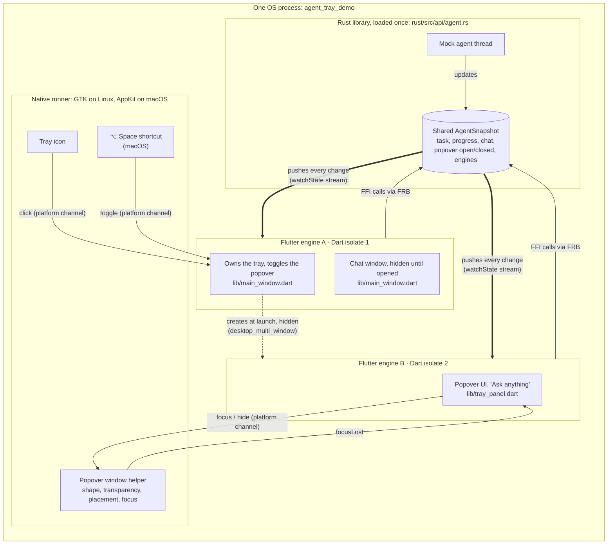
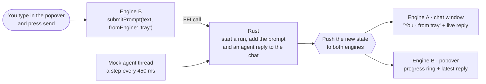
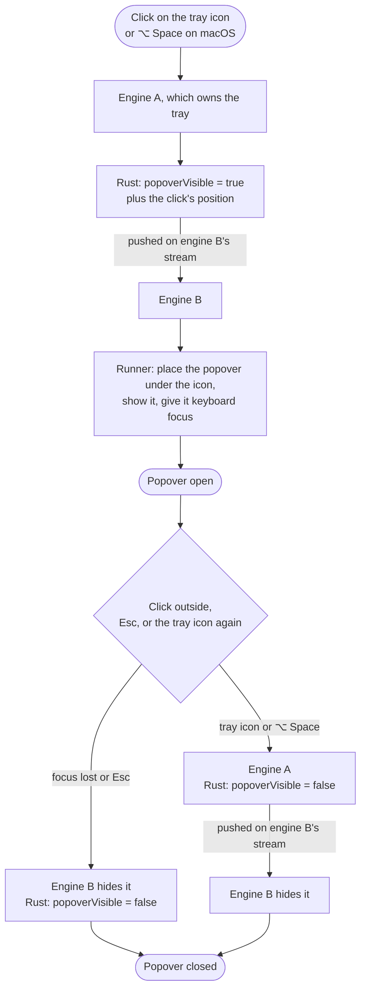

# frb-tray-spike

> **Spike:** a throwaway exploration, not production code. The Flutter package
> and the binary are named `agent_tray_demo`.

A minimal mock of a **tray-first agent client**, like a menu-bar app. Launching
it shows only a tray icon. Clicking the icon opens a small **popover** with an
"Ask anything" box. An optional **chat window** shows the same conversation.

The point of the spike is the architecture behind that:

> **One Flutter app, running as one OS process, with two Flutter engines (the
> popover and the chat window) that share one state kept in Rust through
> [flutter_rust_bridge](https://cjycode.com/flutter_rust_bridge/) (FRB).**

[PROOF-ONE-PROCESS.md](PROOF-ONE-PROCESS.md) shows, from the running app and the
code, that it really is one process with two engines and one Rust state.

## Architecture

### The big picture



Solid arrows are calls, dotted is creation, and thick arrows are state pushed
from Rust to the engines.

### The key ideas

- **One app, two engines.** There's one Flutter project, one Dart codebase
  (`lib/`), one build and one executable. A Flutter **engine** is the runtime
  that runs Dart code and draws a window. At launch, engine A starts and creates
  engine B, a second engine inside the same process, using the
  [`desktop_multi_window`](https://pub.dev/packages/desktop_multi_window) plugin.
  Both engines run the same `main()`, and their startup arguments decide which
  role each one plays (`lib/main.dart`):

  ```dart
  if (args.firstOrNull == 'multi_window') {
    runApp(await bootTrayPanel());   // engine B: the popover
  } else {
    runApp(const MainApp());         // engine A: tray + chat window
  }
  ```

- **The engines can't share Dart objects.** Each engine runs its own Dart
  **isolate**, with separate memory. So the shared state doesn't live in Dart.

- **The shared state lives in Rust.** The Rust library is loaded **once** per
  process, so both engines call into the same copy, and its `static` state is
  shared (`rust/src/api/agent.rs`). Engines **write** by calling Rust functions
  such as `submitPrompt` and `setPopoverVisible`, and **read** only from a
  stream: each engine calls `watchState()`, and every change is pushed to both
  engines. The engines never talk to each other directly.

- **Native code only where Flutter can't reach.** The tray icon, the popover's
  window style (borderless, floating, transparent) and the global shortcut are
  OS features. They live in the native "runner" code (`linux/runner/`,
  `macos/Runner/`), and Dart talks to it over **platform channels**.

### How a prompt flows

You type "refactor payments" in the popover and press send:



Both windows show the same revision number, because they read the same state.

### How the popover opens and closes



Engine B is started **hidden at launch**, so the first click opens the popover
instantly. That costs memory up front: about 110 MB in a debug build. The chat
window shows the measured cost of the second engine.

### Why it's built this way

| Decision | Reason |
|---|---|
| Two engines rather than one | The popover and the chat window are separate OS windows with different behaviour (a floating popover versus a normal window); each engine drives its own window |
| One process rather than two apps | One build, one install, and the engines can share native state cheaply; no inter-process communication |
| State in Rust | Isolates can't share Dart memory; native memory, reached over FFI from both engines, can be shared |
| FRB streams | Every change reaches every engine the same way, so the windows can't disagree |
| Plugins registered per engine | A new engine starts with no platform-channel plugins; the runner registers them for engine B. FRB needs no registration, because it uses FFI |

## Platform differences

| | Linux (GNOME, X11 through XWayland) | macOS |
|---|---|---|
| Tray icon | Legacy X11 tray icon (`linux/runner/linux_tray.cc`); any click toggles the popover, and its menu (Simulate iPhone, Stop, Quit) is in the popover's `⋯` button | `tray_manager`'s status item: left click toggles the popover, right click opens a native menu |
| Popover window | Borderless GTK utility window, always on top, skips the taskbar; transparent around the card when a compositor is running | Non-activating `NSPanel` (like Spotlight): takes keyboard focus without bringing the app forward, transparent around the card |
| Global shortcut | None | <kbd>⌥ Space</kbd> |
| Main window at launch | Hidden; closing it only hides it | Hidden, no Dock icon (`LSUIElement`); closing it only hides it |
| Who shows the popover window | Engine A (a hidden GTK Flutter view never renders, so engine B can't show itself the first time) | Engine B, when the shared state says so |

**Why Linux doesn't use `tray_manager`:** on Linux it creates an AppIndicator,
and GNOME's tray extension opens an AppIndicator's native menu on a single
click without telling the app. The plugin's maintainer confirms it: Linux
"reports no tray icon clicks at all"
([tray_manager#101](https://github.com/leanflutter/tray_manager/issues/101)).
The extension does forward every click on a legacy X11 tray icon, so the Linux
runner uses one. GTK 3 ignores the synthetic events GNOME forwards, so
`linux_tray.cc` reads them with a GDK event filter. Linux also forces X11
(XWayland), because Wayland doesn't let an app position its popover under the
tray.

**Status:** the Linux build is tested end to end. The macOS build compiles in
CI, but hasn't been run on a Mac yet.

## Run

Linux (Ubuntu 24.04):

```bash
sudo apt install clang cmake ninja-build pkg-config libgtk-3-dev liblzma-dev libayatana-appindicator3-dev
flutter run -d linux
```

macOS (needs Xcode and CocoaPods; Flutter can't build a macOS app from Linux):

```bash
rustup target add aarch64-apple-darwin x86_64-apple-darwin
flutter run -d macos
```

`.github/workflows/build.yml` builds and tests both platforms on every push and
uploads the app bundles as artifacts.

### Try it

- Launch it: only the tray icon appears.
- Click the tray icon to toggle the popover under it. On macOS, <kbd>⌥ Space</kbd>
  toggles it from any app.
- Type an instruction in "Ask anything" and send it. The popover shows the
  progress, and the chat window gets the prompt and the agent's live reply.
- Click outside or press <kbd>Esc</kbd> to close the popover.
- The popover's open-in-window button shows the chat window. Closing the chat
  window only hides it.
- The popover's `⋯` menu has **Simulate iPhone session**, **Stop run** and
  **Quit**. Simulate iPhone session runs `checkout` from 0 to 40, and both
  windows show "Driven from iPhone" and the same step.
- Environment switches:
  - `AGENT_DEMO_OPEN_PANEL=1` opens the popover at launch.
  - `AGENT_DEMO_SKIP_PLUGINS=1` skips plugin registration on engine B. The
    popover then shows the `MissingPluginException` it gets.

### Install (Linux)

```bash
linux/packaging/install.sh              # build a release and install it for this user
linux/packaging/install.sh --autostart  # same, and start it at login
linux/packaging/install.sh --uninstall
```

It installs to `~/.local/share/agent_tray_demo`, adds `agent-tray-demo` to
`~/.local/bin` and an "Another" entry to the app grid.

## Tests

```bash
cargo test --manifest-path rust/Cargo.toml   # Rust: run state machine, chat messages, memory reading
flutter test                                 # Flutter: popover and chat window views, without Rust
flutter test integration_test -d linux       # real Rust library: two subscribers see the same run

# The whole app with both engines: engine B types a prompt into the real
# popover, and engine A checks it arrives in the chat through Rust.
flutter drive -d linux --driver=test_driver/integration_test.dart \
  --target=integration_test/two_engines_drive.dart
```

## Code layout

```
lib/                                Dart: one codebase for both engines
  main.dart                         entry point; picks engine A or B from the startup arguments
  main_window.dart                  engine A: tray, creates engine B, toggles the popover, chat window
  tray_panel.dart                   engine B: the popover
  panel_window.dart                 channel to the runner's popover-window helper
  linux_tray.dart                   channel for Linux tray clicks
  global_hotkey.dart                channel for ⌥ Space (macOS)
  ui/                               colours and small shared widgets
  src/rust/                         Dart side of the Rust API, generated by FRB (don't edit)
rust/src/api/agent.rs               the shared state, chat, streams to each engine, mock agent
rust_builder/                       builds the Rust library as part of `flutter build`
linux/runner/                       Linux runner (GTK)
  my_application.cc                 engine A's window; registers plugins on engine B
  linux_tray.cc                     tray icon and its click forwarding
  panel_window.cc                   popover window: utility type, transparency, placement, focus
macos/Runner/MainFlutterWindow.swift  macOS runner: NSPanel popover, ⌥ Space, plugins on engine B
linux/packaging/                    Linux install script, desktop entry, icon
test/                               widget tests
integration_test/                   tests that run the real app with the real Rust library
PROOF-ONE-PROCESS.md                evidence: one process, two engines, one Rust state
```
