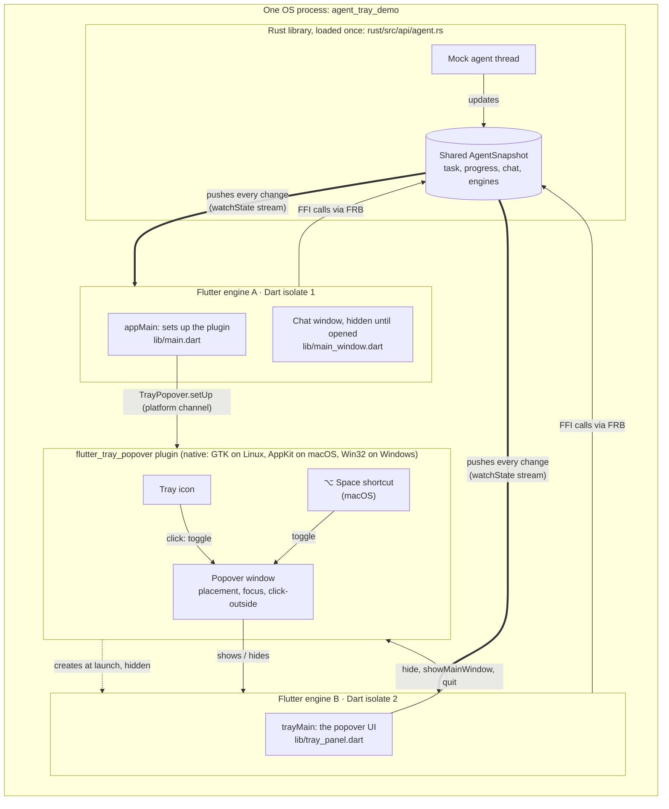
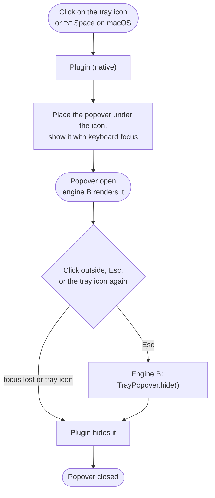

# frb-tray-spike

> **Spike:** a throwaway exploration, not production code. The Flutter package
> and the binary are named `agent_tray_demo`.

A minimal mock of a **tray-first agent client**, like a menu-bar app. Launching
it shows only a tray icon. Clicking the icon opens a small **popover** with an
"Ask anything" box. An optional **chat window** shows the same conversation.

The point of the spike is the architecture behind that:

> **One Flutter app, running as one OS process, with two Flutter engines (the
> popover and the chat window) that share one state kept in Rust through
> [flutter_rust_bridge](https://cjycode.com/flutter_rust_bridge/) (FRB).**

The tray, the popover window and the second engine come from a reusable plugin
in this repo, [`flutter_tray_popover`](packages/flutter_tray_popover).
[PROOF-ONE-PROCESS.md](PROOF-ONE-PROCESS.md) shows, from the running app and the
code, that it really is one process with two engines and one Rust state.

## Architecture

### The big picture



Solid arrows are calls, dotted is creation, and thick arrows are state pushed
from Rust to the engines.

### Where it sits in Flutter's layers

Flutter has three layers: the **framework** (Dart: widgets, your app), the
**engine** (C++: the Dart VM, rendering, platform channels) and the
**embedder** (the native host app: here the runner and the plugin's native
code) ([architectural overview](https://docs.flutter.dev/resources/architectural-overview)).
This app uses each layer twice, once per engine, and adds the Rust library
beside them:


- **Platform channels** (the dashed arrows between the layers) are Flutter's
  standard path between Dart and native code: `TrayPopover.setUp`, `show`,
  `visibilityChanged` and so on go from the framework through the engine to
  the plugin's native code. Channels belong to an engine, so plugins are
  registered on each engine.
- **FFI** (the arrows to and from the Rust library) bypasses the engine and
  the embedder: `submitPrompt` and `watchState` call the Rust library directly
  through `dart:ffi`, and Rust posts changes back to each engine's Dart port
  (`Dart_PostCObject`). So the shared state needs no per-engine registration,
  only `RustLib.init()` in each isolate.
- **What's shared and what isn't:** the Dart VM, `libflutter` and the Rust
  library exist once per process. The engine instances, their isolates,
  threads, windows and plugin channels exist twice.

### The key ideas

- **One app, two engines.** There's one Flutter project, one Dart codebase
  (`lib/`), one build and one executable. A Flutter **engine** is the runtime
  that runs Dart code and draws a window. At launch, engine A runs `appMain`,
  which calls `TrayPopover.setUp(...)`. The plugin then creates the tray icon
  and engine B, a second engine inside the same process, which runs `trayMain`
  (`lib/main.dart`):

  ```dart
  void main(List<String> args) =>
      TrayPopover.run(args: args, app: appMain, popover: trayMain);

  @pragma('vm:entry-point')        // keeps trayMain in release builds
  Future<void> trayMain() async { ... runApp(await bootTrayPanel()); }
  ```

  macOS and Windows start engine B at `trayMain` by name. The Linux embedder can only start
  an engine at `main`, so there engine B runs `main` with a `tray_popover`
  argument, and `TrayPopover.run` routes it to `trayMain`.

- **The engines can't share Dart objects.** Each engine runs its own Dart
  **isolate**, with separate memory. So the shared state doesn't live in Dart.

- **The shared state lives in Rust.** The Rust library is loaded **once** per
  process, so both engines call into the same copy, and its `static` state is
  shared (`rust/src/api/agent.rs`). Engines **write** by calling Rust functions
  such as `submitPrompt`, and **read** only from a stream: each engine calls
  `watchState()`, and every change is pushed to both engines. The engines never
  talk to each other directly.

- **The plugin owns everything native.** The tray icon, the popover window
  (placement, focus, transparency, click-outside) and the global shortcut are
  OS features, implemented once in the plugin's native code and shared by both
  engines. Showing and hiding the popover happens natively, without a round
  trip through Dart.

### How a prompt flows

You type "refactor payments" in the popover and press send:


Both windows show the same revision number, because they read the same state.

### How the popover opens and closes



Engine B is started **hidden at launch**, so the first click opens the popover
instantly. That costs memory up front: about 110 MB in a debug build. The chat
window shows the measured cost of the second engine.

### Why it's built this way

| Decision | Reason |
|---|---|
| Two engines rather than one | The popover and the chat window are separate OS windows with different behaviour (a floating popover versus a normal window); each engine drives its own window |
| One process rather than two apps | One build, one install, and the engines can share native state cheaply; no inter-process communication |
| State in Rust | Isolates can't share Dart memory; native memory, reached over FFI from both engines, can be shared |
| FRB streams | Every change reaches every engine the same way, so the windows can't disagree |
| A plugin for the tray and the popover | The native parts are generic, so another app can reuse them with a `setUp` call, a `trayMain` and one runner line |
| Plugins registered per engine | A new engine starts with no platform-channel plugins, and only the app can call its own generated registrant, so the runner hands the plugin a callback for engine B. FRB needs no registration, because it uses FFI |

## Using the plugin

```dart
// engine A, once
await TrayPopover.setUp(icon: 'assets/tray_icon.png', optionSpaceShortcut: true);

// either engine
await TrayPopover.show();            // also hide(), toggle(), isVisible()
await TrayPopover.showMainWindow();
await TrayPopover.quit();
TrayPopover.visibilityChanges.listen((visible) { ... });
```

And one block in each runner, so engine B gets the app's plugins:

```c
// linux/runner/my_application.cc
flutter_tray_popover_plugin_set_engine_created_callback(
    [](FlPluginRegistry* registry) { fl_register_plugins(registry); });
```
```swift
// macos/Runner/MainFlutterWindow.swift
FlutterTrayPopoverPlugin.onEngineCreated = { RegisterGeneratedPlugins(registry: $0) }
```
```cpp
// windows/runner/flutter_window.cpp
FlutterTrayPopoverPluginSetEngineCreatedCallback(
    [](flutter::PluginRegistry* registry) { RegisterPlugins(registry); });
```

See [packages/flutter_tray_popover/README.md](packages/flutter_tray_popover/README.md)
for the full API.

## Platform differences

| | Linux (GNOME, X11 through XWayland) | macOS | Windows |
|---|---|---|---|
| Tray icon | Legacy X11 tray icon; any click toggles the popover, and its menu (Simulate iPhone, Stop, Quit) is in the popover's `⋯` button | Status item; any click toggles the popover | Notification-area icon; a left or right click toggles the popover |
| Popover window | Borderless GTK utility window, always on top, skips the taskbar; transparent around the card when a compositor is running | Non-activating `NSPanel` (like Spotlight): takes keyboard focus without bringing the app forward, transparent around the card | Borderless tool window, always on top, no taskbar button, rounded corners on Windows 11; opaque, so the card fills it edge to edge |
| How engine B starts | `main` with the `tray_popover` argument (no named entry points on Linux) | `trayMain` by name | `trayMain` by name |
| Global shortcut | None | <kbd>⌥ Space</kbd> | None (<kbd>Alt Space</kbd> is the system window menu) |
| Main window at launch | Hidden; closing it only hides it (the plugin's `keepAliveOnWindowClose`) | Hidden, no Dock icon (`LSUIElement`); closing it only hides it (`AppDelegate`) | Hidden; closing it only hides it (the plugin's `keepAliveOnWindowClose`) |

**Why the Linux tray isn't an AppIndicator:** GNOME's tray extension opens an
AppIndicator's native menu on a single click without telling the app. The
`tray_manager` plugin's maintainer confirms Linux "reports no tray icon clicks
at all" ([tray_manager#101](https://github.com/leanflutter/tray_manager/issues/101)).
The extension does forward every click on a legacy X11 tray icon, so the plugin
uses one. GTK 3 ignores the synthetic events GNOME forwards, so the plugin reads
them with a GDK event filter. Linux also forces X11 (XWayland, in
`linux/runner/main.cc`), because Wayland doesn't let an app position its
popover under the tray.

**Status:** the Linux build is tested end to end. macOS has had its first run
on a real Mac: at launch nothing appeared, because the main engine only starts
when its window is shown and that window is hidden. The runner now starts it
explicitly (commit `5ee5379`, release `build-10`). The rest of the Mac
checklist below is still to be confirmed. The Windows code is new: CI builds
it, but it hasn't been run on a Windows machine yet.

## Run

### Download and run a build (no tools needed)

Every successful build of `main` is published as a public
[GitHub release](https://github.com/vymalo/frb-tray-spike/releases), named
`build-<number>`. One command downloads the newest build, unpacks it,
installs it for your user and starts it:

**macOS** (universal: Apple silicon and Intel, macOS 12 or later). Installs to
`~/Applications/agent_tray_demo.app`:

```bash
curl -fsSL https://raw.githubusercontent.com/vymalo/frb-tray-spike/main/scripts/run-macos.sh | bash
```

**Linux** (x64, GTK 3, X11 or XWayland; Ubuntu 22.04 or newer). Installs to
`~/.local/opt/frb-tray-spike/bundle`:

```bash
curl -fsSL https://raw.githubusercontent.com/vymalo/frb-tray-spike/main/scripts/run-linux.sh | bash
```

**Windows** (x64, Windows 10 or 11), in PowerShell. Installs to
`%LOCALAPPDATA%\frb-tray-spike\agent_tray_demo`:

```powershell
irm https://raw.githubusercontent.com/vymalo/frb-tray-spike/main/scripts/run-windows.ps1 | iex
```

From a clone, the same scripts take options: a specific build, another
folder, or running in the terminal with the app's logs (Ctrl-C quits):

```bash
scripts/run-macos.sh --build 12 --dir ~/Desktop --logs
```
```bash
scripts/run-linux.sh --build 12 --dir ~/apps --logs
```
```powershell
powershell -ExecutionPolicy Bypass -File scripts\run-windows.ps1 -Build 12 -Dir C:\apps -Logs
```

Each script stops a copy that's already running, replaces the previous
install, and prints where the tray icon is. If the app exits straight away,
the Linux script prints its output.

**Or download the files yourself.** The newest build is always at these links:

- **macOS:** [agent_tray_demo-macos.zip](https://github.com/vymalo/frb-tray-spike/releases/latest/download/agent_tray_demo-macos.zip).
  The app isn't signed or notarized, so macOS blocks it the first time. Unzip
  it, then clear the quarantine flag (`xattr -dr com.apple.quarantine
  agent_tray_demo.app`), or right-click the app and choose **Open**. Start it
  from a terminal (`./agent_tray_demo.app/Contents/MacOS/agent_tray_demo`) to
  see its logs, including the plugin's `NSLog` lines.
- **Linux:** [agent_tray_demo-linux-x64.tar.gz](https://github.com/vymalo/frb-tray-spike/releases/latest/download/agent_tray_demo-linux-x64.tar.gz).
  Extract it and run `bundle/agent_tray_demo`.
- **Windows:** [agent_tray_demo-windows-x64.zip](https://github.com/vymalo/frb-tray-spike/releases/latest/download/agent_tray_demo-windows-x64.zip).
  Unzip it and run `agent_tray_demo\agent_tray_demo.exe`. It isn't signed, so
  SmartScreen may stop it: choose **More info**, then **Run anyway**. The zip
  includes the Visual C++ runtime. The tray icon may first appear in the
  overflow behind the taskbar's **^** arrow. A Windows build that fails in CI
  doesn't block the release, so this file is missing from releases whose
  Windows build failed.

### Build from source

**Linux** (Ubuntu 22.04 or newer):

```bash
sudo apt install clang cmake ninja-build pkg-config libgtk-3-dev liblzma-dev
flutter run -d linux
```

**Windows** (Flutter can't build a Windows app on another OS, so this needs
Windows):

1. Install [Visual Studio](https://visualstudio.microsoft.com/downloads/) (not
   VS Code) with the **Desktop development with C++** workload.
2. Install [Flutter](https://docs.flutter.dev/get-started/install/windows)
   (stable channel) and [Rust](https://rustup.rs) (the default MSVC toolchain).
3. Run it from the repository's root:
   ```powershell
   flutter run -d windows
   ```
   Or build the release app, as CI does:
   ```powershell
   flutter build windows --release
   ```
   The app is then in `build\windows\x64\runner\Release`.

**macOS** (Flutter can't build a macOS app on Linux, so this needs a Mac):

1. Install [Xcode](https://apps.apple.com/app/xcode/id497799835) and its
   command-line tools (`xcode-select --install`), plus
   [CocoaPods](https://guides.cocoapods.org/using/getting-started.html)
   (`brew install cocoapods`).
2. Install [Flutter](https://docs.flutter.dev/get-started/install/macos) (stable
   channel) and [Rust](https://rustup.rs), then add the Mac targets the Rust
   library is built for:
   ```bash
   rustup target add aarch64-apple-darwin x86_64-apple-darwin
   ```
3. Run it from the repository's root:
   ```bash
   flutter run -d macos
   ```
   Or build the release app, as CI does:
   ```bash
   flutter build macos --release
   ```
   The app is then at `build/macos/Build/Products/Release/agent_tray_demo.app`.

The FRB bindings are already generated and committed, so you don't need
`flutter_rust_bridge_codegen` unless you change `rust/src/api/`.

### What to check on a Mac

The first run on a Mac found that the tray icon never appeared (fixed in
`build-10`). These are the things to confirm on that build or later:

1. After launch, there's **no Dock icon and no window**, only the icon in the
   menu bar.
2. **Clicking the menu-bar icon** opens the popover, centred just below the
   icon, as a rounded card with a shadow (transparent around it).
3. You can **type in "Ask anything" straight away**, and the app's main window
   doesn't come forward.
4. **Clicking anywhere else** closes the popover; clicking the icon again
   toggles it.
5. **<kbd>⌥ Space</kbd>** opens and closes it from any app. If another app
   owns that shortcut, a log line says so.
6. Sending a prompt shows its progress in the popover; the popover's
   open-in-window button shows the chat window with the same conversation.
7. **Quit** in the popover's `⋯` menu ends the app.

### What to check on Windows

The Windows code is built by CI but hasn't been run on Windows yet:

1. After launch there's **no window**, only the tray icon (maybe behind the
   taskbar's **^** arrow; drag it onto the taskbar to keep it visible).
2. **Clicking the tray icon** (left or right) opens the popover just above it,
   or beside it with the taskbar on another edge, and clicking it again
   closes it.
3. You can **type in "Ask anything" straight away**.
4. **Clicking anywhere else** closes the popover.
5. Sending a prompt shows its progress in the popover; the popover's
   open-in-window button shows the chat window with the same conversation,
   and closing that window only hides it.
6. **Quit** in the popover's `⋯` menu ends the app and removes the tray icon.

`.github/workflows/build.yml` builds and tests all three platforms on every
push, uploads the bundles as workflow artifacts, and publishes the release
above for every build of `main` where Linux and macOS pass.

### Try it

- Launch it: only the tray icon appears.
- Click the tray icon to toggle the popover next to it. On macOS, <kbd>⌥ Space</kbd>
  toggles it from any app.
- Type an instruction in "Ask anything" and send it. The popover shows the
  progress, and the chat window gets the prompt and the agent's live reply.
- Click outside or press <kbd>Esc</kbd> to close the popover.
- The popover's open-in-window button shows the chat window. Closing the chat
  window only hides it.
- The popover's `⋯` menu has **Simulate iPhone session**, **Stop run** and
  **Quit**. Simulate iPhone session runs `checkout` from 0 to 40, and both
  windows show "Driven from iPhone" and the same step.
- Environment switches:
  - `AGENT_DEMO_OPEN_PANEL=1` opens the popover at launch.
  - `AGENT_DEMO_SKIP_PLUGINS=1` skips plugin registration on engine B. The
    popover then shows the `MissingPluginException` it gets.

### Install (Linux)

```bash
linux/packaging/install.sh              # build a release and install it for this user
linux/packaging/install.sh --autostart  # same, and start it at login
linux/packaging/install.sh --uninstall
```

It installs to `~/.local/share/agent_tray_demo`, adds `agent-tray-demo` to
`~/.local/bin` and an "Another" entry to the app grid.

## Tests

```bash
cargo test --manifest-path rust/Cargo.toml   # Rust: run state machine, chat messages, memory reading
flutter test                                 # Flutter: popover and chat window views, without Rust
(cd packages/flutter_tray_popover && flutter test)   # the plugin's Dart API
flutter test integration_test/shared_state_test.dart -d linux   # real Rust library: two subscribers

# The whole app with both engines: engine B types a prompt into the real
# popover, and engine A checks it arrives in the chat through Rust.
flutter drive -d linux --driver=test_driver/integration_test.dart \
  --target=integration_test/two_engines_drive.dart
```

## Code layout

```
lib/                                Dart: one codebase for both engines
  main.dart                         main → appMain (engine A) or trayMain (engine B)
  main_window.dart                  engine A: sets up the plugin, chat window
  tray_panel.dart                   engine B: the popover
  ui/                               colours and small shared widgets
  src/rust/                         Dart side of the Rust API, generated by FRB (don't edit)
rust/src/api/agent.rs               the shared state, chat, streams to each engine, mock agent
rust_builder/                       builds the Rust library as part of `flutter build`
packages/flutter_tray_popover/      the plugin: tray icon, popover window, engine B, ⌥ Space
  lib/flutter_tray_popover.dart     Dart API (TrayPopover)
  linux/flutter_tray_popover_plugin.cc      Linux implementation (GTK, X11)
  macos/Classes/FlutterTrayPopoverPlugin.swift  macOS implementation (NSStatusItem, NSPanel)
  windows/flutter_tray_popover_plugin.cpp   Windows implementation (Shell_NotifyIcon, Win32 window)
linux/runner/                       Linux runner: forces X11, registers plugins on engine B
macos/Runner/                       macOS runner: registers plugins on engine B, menu-bar app settings
windows/runner/                     Windows runner: registers plugins on engine B, starts hidden
linux/packaging/                    Linux install script, desktop entry, icon
scripts/                            download, install and run a CI build: run-macos.sh, run-linux.sh, run-windows.ps1
test/                               widget tests
integration_test/                   tests that run the real app with the real Rust library
PROOF-ONE-PROCESS.md                evidence: one process, two engines, one Rust state
```

## Related: Flutter's own multi-window support

This spike uses **two engines**, one per window, because Flutter on desktop has
so far drawn one window per engine. Flutter is adding **multi-window support to
a single engine**: several native windows in one widget tree, so they can share
Dart state directly, without a native store like the Rust library here. If that
becomes stable on Linux and macOS, the popover could be a second window of the
same engine instead of a second engine. That would mean less memory, and no
cross-engine state.

Status when this was written (October 2026): **experimental**, on the `main`
channel only, behind a feature flag. The stable Flutter used here (3.41) has no
windowing code in its Linux engine.

- [Introducing the Desktop Windowing API for Flutter](https://flutter.dev/blog/desktop-windowing-apis):
  the official announcement, from August 2026. It's available on the `main`
  channel with `flutter config --enable-windowing`, "hidden behind an
  experimental feature flag and are therefore subject to change". All windows
  share one widget tree, so state is shared between them.
- [flutter#30701, "Support multiple windows for desktop shells"](https://github.com/flutter/flutter/issues/30701):
  the long-standing tracking issue, still open.
- [flutter#142845, "Multi View for Windows/MacOS"](https://github.com/flutter/flutter/issues/142845):
  the umbrella issue for the multi-view work on Windows and macOS, still open.
- [flutter#194784](https://github.com/flutter/flutter/issues/194784): a request
  to let the windowing API own the app's primary window.
- [Desktop Multi-Window Support (design doc)](https://docs.google.com/document/u/0/d/11_4wntz_9IJTQOo_Qhp7QF4RfpIMTfVygtOTxQ4OGHY/mobilebasic):
  the public design document.
- [Canonical: Bringing multiple windows to Flutter desktop apps](https://forum.itsallwidgets.com/t/canonical-bringing-multiple-windows-to-flutter-desktop-apps/2412):
  background on Canonical's work on the feature.
- [Multiple Flutter instances](https://docs.flutter.dev/add-to-app/multiple-flutters):
  the official docs on running several engines in one app, which is the
  approach this spike takes today.
